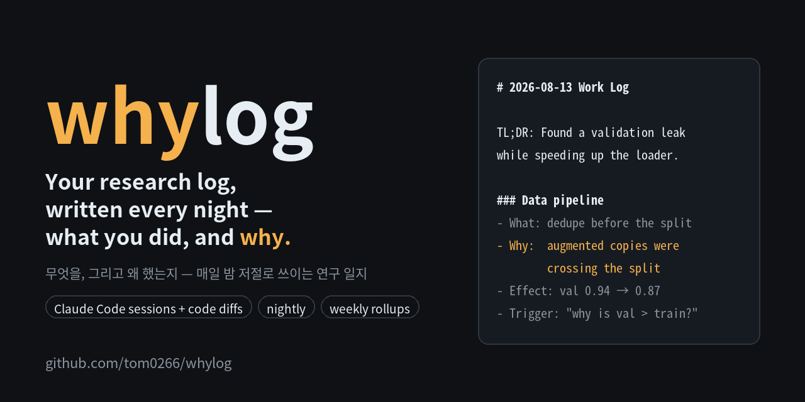
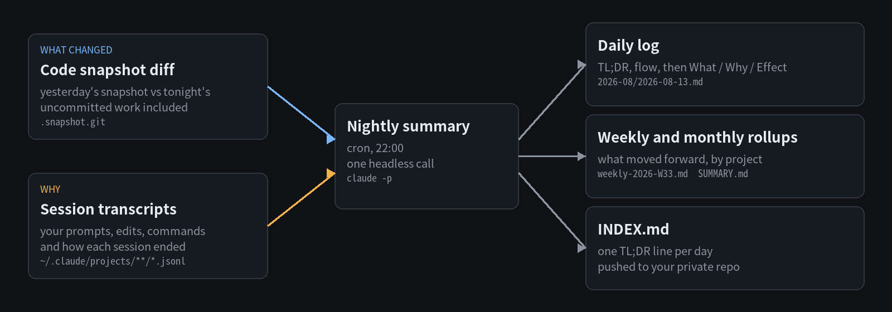

# whylog

[English](README.md) | **한국어**



[](LICENSE)


[](https://github.com/tom0266/whylog/actions/workflows/lint.yml)

**Claude Code 세션 기록과 코드 diff로 매일 연구 일지를 자동으로 써 주는 도구.**

평소처럼 연구하면, 매일 밤 그날 무엇을 **왜** 했는지가 저절로 정리돼 내 비공개 GitHub 저장소에 쌓입니다. 직접 쓸 일은 없습니다.

```markdown
# 2026-08-13 작업 일지

**TL;DR**: 데이터 로더를 정리하다가 검증 세트 누수를 발견해 바로잡았다.

**오늘의 흐름**: 느린 데이터 로더를 빠르게 하려고 시작했다. 프로파일링 중 검증 점수가
지나치게 높다는 의심이 들어 분할 코드와 설정을 직접 대조했고, 학습 샘플의 증강 사본이
검증 쪽에 섞여 들어가는 것을 확인했다. 분할을 고친 뒤 베이스라인을 다시 돌렸다.

### 데이터 파이프라인 — 검증 누수 적발
- **무엇을**: `split.py`에서 중복 제거를 train/val 분할 앞으로 옮김.
- **왜**: 같은 샘플의 증강 사본이 양쪽에 들어가고 있었음.
- **기대효과**: 검증 점수가 현실적인 수준으로 내려옴. 이전 결과는 재확인 필요.
- **계기**: 프로파일링 중 "왜 val이 train보다 좋지?"라는 의문.
```

전체 샘플은 [`examples/`](examples/)에 있습니다: 일일 일지(영어·한국어), 주간 요약, 인덱스.

## 특징

- **완전 자동**: 매일 밤 cron이 씁니다. 세션을 열어 둘 필요도, 뭔가 입력할 필요도 없습니다.
- **무엇을 바꿨나 — `git log`가 아닌 스냅샷 diff**: 커밋하지 않은 작업이나 늦게 한 커밋도 그날 것으로 정확히 잡힙니다.
- **왜 했나 — 세션 기록**: Claude Code 트랜스크립트에서 내 지시, 편집한 파일, 실행한 명령, 세션의 결론을 뽑아 변경마다 의도를 짝지어 줍니다.
- **한계가 있는 자동 복구**: 서버가 꺼져 밤 실행을 놓치거나 요약이 실패해도, 다음 실행이 최근 3일 중 빠진 날을 메웁니다. 놓친 날은 세션 기록만으로 복구되고 코드 diff는 복구되지 않습니다. 그 변경은 다음 정상 실행의 diff에 합쳐집니다.
- **쉬는 날은 공짜**: 활동이 없는 날은 모델을 부르지 않고 한 줄만 남깁니다.
- **롤업**: cron에 등록되는 주간·월간 요약, 그리고 날짜별 TL;DR 한 줄을 모은 `INDEX.md`.
- **내 소유의 기록**: 내 git 저장소에 쌓이는 평범한 Markdown. 버전이 남고 비공개 원격에 push됩니다.
- **한국어/영어**: `whylog.conf`의 `LANGUAGE`로 고릅니다.

## 5분 설치

필요한 것: Linux 또는 macOS, [Claude Code](https://docs.claude.com/en/docs/claude-code) (`claude` CLI, 로그인 상태), `git`, `python3` (3.7 이상, 코드가 `datetime.fromisoformat`을 씀), `crontab`. 선택: `gh` (비공개 GitHub 저장소를 대신 만들어 주고, 원격이 비공개인지 확인함), `timeout` (macOS는 `gtimeout`, 모델 호출 한 번을 `TIMEOUT_SEC`초로 제한함. 없으면 시간 제한 없이 호출). macOS에서 작업 폴더가 Documents·Desktop 아래에 있으면 cron에 "전체 디스크 접근 권한"이 필요할 수 있습니다. 매일 실사용 중인 환경은 Linux이고, macOS는 아직 실기 테스트 전입니다.

```bash
git clone https://github.com/tom0266/whylog ~/whylog
cd ~/whylog
vi whylog.conf        # 대개 그대로 둬도 됩니다 (아래 참조)
bash install.sh
```

`install.sh`가 하는 일: 필수 도구 확인 → 일지 저장소(git) 준비 → 원한다면 GitHub 비공개 저장소 생성 → 코드 스냅샷 기준선 생성 → cron 등록 → 동작 확인(dry-run). 여러 번 다시 실행해도 안전합니다. dry-run은 요약할 활동이 있으면 모델을 실제로 호출하므로 최대 `TIMEOUT_SEC`초까지 기다릴 수 있습니다.

> clone 직후에는 `origin`이 이 도구 저장소를 가리킵니다. `install.sh`가 이 연결을 자동으로 끊어 **내 일지가 이곳으로 push되지 않게** 합니다. clone 대신 **Use this template** 버튼을 써도 되는데, 이때 새 저장소는 **반드시 Private으로 만드세요.** `origin`이 공개 저장소이면(`gh`로 확인) `install.sh`는 아무것도 등록하지 않고 중단하며, `daily.sh`도 `origin`이 도구 저장소를 가리키면 push를 거부합니다.

실행 시각을 바꾸려면 `CRON_TIME="30 19" bash install.sh` (분 시 순서, 기본 `0 22` = 밤 10시). `30 09`처럼 앞자리 0을 써도 되며, 형식과 범위를 검사합니다.

등록되는 cron 작업은 다음과 같습니다.

| 작업 | 시각 | 명령 |
|---|---|---|
| 일일 일지 | `CRON_TIME` | `daily.sh` |
| 주간 요약 | 일일 실행 30분 뒤, 일요일 | `rollup.sh week` |
| 월간 요약 | 일일 실행 30분 뒤, 매달 1일 | `rollup.sh month last` (방금 끝난 달) |

일일 실행 30분 뒤가 자정을 넘기면 주간 작업은 일요일이 아니라 월요일에 등록됩니다. cron의 `PATH`는 `claude`가 설치된 폴더, `~/.local/bin`, `/usr/local/bin`, `/opt/homebrew/bin`, `/usr/bin`, `/bin` 순이라 npm 전역·nvm·Homebrew로 설치한 경우에도 cron에서 돕니다. 출력은 일지 폴더의 `cron.log`에 쌓입니다. `claude`를 옮겼다면 `install.sh`를 다시 실행하세요.

git `user.name`·`user.email`이 없어도 됩니다. 없으면 커밋은 `whylog <whylog@localhost>`로 남고, 설치는 안내만 출력합니다.

## 설정 (`whylog.conf`)

| 항목 | 기본값 | 설명 |
|---|---|---|
| `TRACK_REPO` | `$HOME` | 기록 대상 작업 폴더. 이 아래의 코드·문서 변경과 세션이 대상 |
| `WORKLOG_DIR` | (whylog를 clone한 폴더) | 일지가 쌓이는 곳 |
| `MODEL` | `opus` | 요약 모델. 사용량을 줄이려면 `sonnet` |
| `LANGUAGE` | `en` | 일지 언어: `ko` 또는 `en` |
| `CLAUDE_BIN` | (자동 탐지) | `claude` 실행 파일 경로 |
| `TIMEOUT_SEC` | 600 | 모델 호출 한 번의 제한 시간(초) |
| `WHYLOG_CONF` | (`install.sh` 옆의 `whylog.conf`) | 파일 안의 항목이 아니라 환경변수. 설정 파일을 도구 폴더 밖에 둘 때 경로를 지정. `daily.sh`·`rollup.sh`·`install.sh`가 읽고, 값이 있으면 `install.sh`가 cron 줄에도 넣어 줌 |
| `DIFF_BUDGET` 등 | 60000 / 6000 / 40 | 프롬프트에 실을 코드 diff 분량 상한 |
| `SESS_BUDGET` | 30000 | 세션 기록에서 뽑아 실을 근거 분량 상한 |
| `SKIP_DIR` | (빈 값) | 경로에 이 문자열이 있는 세션·프롬프트·커밋·수정 파일은 기록하지 않음 (여러 개는 쉼표로 구분). 코드 diff에는 **적용되지 않음** |
| `EXCLUDE` | (빈 값) | 코드 diff에서 뺄 폴더. 한 줄에 공백으로 구분한 gitignore 패턴 (예: `"/datasets/ /runs/*/outputs/"`). 스냅샷 diff에만 적용 |

## 어떻게 그날 한 일을 아는가



정확도의 두 축이 있습니다.

**무엇을 바꿨나 — 코드 스냅샷.** `.snapshot.git`(일지 저장소 안의 별도 git)에 매일 밤 작업 폴더 스냅샷을 뜹니다. "어제 스냅샷 대비 오늘 diff"가 그날 바꾼 것입니다. 작업 폴더의 `git status`를 쓰면 커밋이 뜸한 저장소에서 수개월치 누적 변경이 "오늘 한 일"로 둔갑하기 때문에, 별도 스냅샷을 두는 것이 핵심입니다.

diff는 하루 수십만 자에 이르므로 전부 넣을 수 없습니다. **변경량이 큰 파일부터 파일당 상한을 두고** 담습니다. (단순히 앞에서 잘라내면 git diff의 경로 알파벳순 때문에 `.`으로 시작하는 에디터 설정 폴더가 예산을 다 먹고 정작 연구 코드는 하나도 안 실립니다. 실제로 그렇게 돌아간 날이 있었습니다.)

**왜 했나 — 세션 기록.** `~/.claude/projects/**/*.jsonl` 트랜스크립트에서 그날치 이벤트만 뽑습니다: 내가 내린 지시/질문, 실제로 편집된 파일, 실행한 명령, 세션이 어떻게 끝났는지. 원문(세션 하나가 40MB를 넘기도 합니다)은 넣지 않고 이벤트만 추출합니다. "무엇을"과 "왜"가 짝지어지는 건 이 축 덕분입니다.

그날의 커밋(`TRACK_REPO` 바로 아래 독립 git 저장소들의 커밋 포함)도 보조 근거로 들어갑니다. 변경이 없는 날도 스냅샷 커밋(`--allow-empty`)이 남으므로, 조용한 날이 나중에 "스냅샷 없음"으로 오인되지 않습니다. 한글이나 공백이 든 파일명도 diff에 그대로 들어갑니다.

전송 전에 diff와 세션 근거는 비밀값처럼 보이는 문자열을 `[REDACTED]`로 바꾸는 필터를 거칩니다: `sk-`·`ghp_` 형태 토큰, `AKIA` 키, `xox-` 형태 토큰, `PRIVATE KEY` 머리줄, `password=`·`token=`·`secret=`·`api_key=` 뒤의 값. 완벽한 보장이 아니라 그물입니다. 커밋 메시지는 거르지 않고, 다른 모양의 비밀값은 통과합니다. 진짜 비밀값은 추적 파일과 프롬프트에 넣지 마세요.

## 쓰는 법

| 하고 싶은 것 | 명령 |
|---|---|
| 지금 즉시 오늘 일지 생성 | `bash scripts/daily.sh` |
| 기록하지 않고 결과만 미리보기 | `bash scripts/daily.sh --dry-run` |
| 놓친 날 복구 | `bash scripts/daily.sh --date 2026-08-13` |
| 주간 요약 | `bash scripts/rollup.sh week` |
| 월간 요약 | `bash scripts/rollup.sh month 2026-08` (`last`는 지난달) |
| 인덱스 갱신 | `bash scripts/rollup.sh index` |

주간 요약은 일요일 밤, 월간 요약은 매달 1일에 cron으로 돌고(설치 절 참조), `INDEX.md`는 매일 일지 작성 후 갱신됩니다.

자동 요약이 틀렸다면 Claude 세션에서 **"오늘 일지 이 부분 고쳐줘"**라고 하면 됩니다.

## 구조

```
whylog/
├── whylog.conf          # 설정 — 환경이 다르면 여기만 고치면 된다
├── install.sh           # 설치 (멱등)
├── scripts/
│   ├── daily.sh             # 일일 기록 (cron 매일 밤)
│   ├── rollup.sh            # 주간/월간 요약 + INDEX (cron 주간·월간)
│   ├── extract_sessions.py  # 세션 트랜스크립트 → 이벤트 추출
│   └── split_summary.py     # 요약이 거부·오형식일 때 프로젝트별로 나눠 다시 요약하는 대체 경로
├── .whylog-template     # 이 도구 저장소 이름 (내 일지가 이곳으로 push되는 것을 막는 데 쓰임)
├── examples/            # 출력 샘플
├── cron.log             # cron 작업 출력 (첫 실행 때 생김, 커밋 안 됨)
├── INDEX.md             # 전체 날짜의 TL;DR 한 줄 목록
└── YYYY-MM/YYYY-MM-DD.md
```

## 개인정보와 알아 둘 것

- **일지 저장소는 비공개로 두세요.** 무엇을 왜 했는지가 그대로 남습니다 — 미발표 결과, 실패한 시도, 판단 근거까지. 그 정직함이 이 일지의 가치인데, 공개되는 순간 자기검열이 시작됩니다. 남들과 공유하려면 원본은 비공개로 두고 주간 요약만 따로 내보내세요.
- **요약을 만들 때 코드 diff와 지시 내용이 Claude로 전송됩니다.** 사내·기관 정책상 코드 외부 전송이 제한된다면 `TRACK_REPO`를 해당 폴더 밖으로 한정하세요.
- `EXCLUDE`와 `SKIP_DIR`은 적용 범위가 달라서 하나만으로는 폴더가 일지에서 완전히 빠지지 않습니다. `EXCLUDE`(또는 `.snapshot.git/info/exclude` 직접 편집)는 스냅샷 diff에서만 파일을 뺍니다. `SKIP_DIR`은 세션·프롬프트·`TRACK_REPO` 바로 아래 저장소의 커밋·수정 파일 목록에서 빼지만 diff는 거르지 않습니다. 민감한 폴더는 둘 다 쓰되, 어느 쪽도 보장으로 믿지 마세요.
- `TRACK_REPO` 자체의 커밋 목록에는 `SKIP_DIR`이 적용되지 않습니다. 패키지·가상환경 폴더(conda, venv, `site-packages`)와 에디터 설정은 기본으로 제외되므로, 라이브러리를 설치해도 그날 diff가 라이브러리 코드로 뒤덮이지 않습니다.
- `.claude/`가 작업 폴더의 `.gitignore`에 있으면 **스킬·에이전트를 만든 작업은 코드 diff에 안 잡힙니다.** 다만 세션 기록 축에서는 잡히므로 완전히 누락되지는 않습니다.
- 밤 실행 이후의 세션은 그날 일지에 들어가지 않습니다(코드 변경은 다음 날 diff에 잡힘). 늦게까지 일한다면 `CRON_TIME`을 늦추세요.

## 문제 해결

먼저 일지 폴더의 `cron.log`를 보세요(`tail -50 cron.log`). 모델 호출이 실패하면 오류의 마지막 몇 줄이 `[error] claude call failed:` 아래에 남습니다.

| 증상 | 확인할 것 |
|---|---|
| 그날 일지에 `⚠️ Claude 자동 요약 실패` 머리글이 있음 | 호출이 실패한 것. 이유는 `cron.log`에서 확인. 다음 실행이 최근 3일 중 빠진 날을 다시 시도하고, 더 오래된 날은 `bash scripts/daily.sh --date YYYY-MM-DD`로 복구 |
| 로그인이 만료됐거나 모델 호출이 거부됨 | `claude`를 직접 한 번 실행해 로그인 상태를 확인한 뒤 `bash scripts/daily.sh`로 다시 시도 |
| 사용량 한도 도달 | 호출이 같은 방식으로 실패하고 이후 실행에서 다시 시도됨. `MODEL="sonnet"`으로 사용량을 줄일 수 있음 |
| `cron.log`에 `claude executable not found` | cron은 환경이 최소라서 생김. `whylog.conf`에 `CLAUDE_BIN`을 쓰거나 `install.sh`를 다시 실행해 cron `PATH`에 `claude` 폴더가 들어가게 함 |
| git 사용자 정보 오류 | 생기지 않아야 정상: 커밋은 `whylog <whylog@localhost>`로 대체됨. 내 이름을 쓰려면 `git config --global user.name`, `user.email` 설정 |
| 설치가 "origin is a PUBLIC repo"로 중단됨 | 메시지대로 저장소를 비공개로 바꾸거나 `origin`을 비공개 저장소로 돌린 뒤 `install.sh`를 다시 실행 |
| 무엇이 전송될지 확인하고 싶음 | `bash scripts/daily.sh --dry-run`이 일지·스냅샷·커밋을 만들지 않고 근거 분량과 요약을 출력 |

## 업데이트

기본 구성에서는 `install.sh`가 `origin`을 끊어 두었으므로 `git pull`로 새 판을 받을 수 없습니다. 도구 저장소를 두 번째 원격으로 추가하세요.

```bash
cd ~/whylog
git remote add upstream https://github.com/tom0266/whylog   # 이름은 .whylog-template 에도 들어 있음
git pull upstream main
bash install.sh                                              # cron 줄을 갱신, 반복해도 안전
```

`whylog.conf`를 고쳤다면 병합 충돌은 직접 해결하세요. `WHYLOG_CONF`로 설정을 폴더 밖에 두면 충돌이 없습니다. `upstream`에는 push하지 마세요.

## 제거

```bash
crontab -l | grep -v -e whylog/scripts/daily.sh -e whylog/scripts/rollup.sh | crontab -
```

`whylog`가 아닌 다른 폴더 이름으로 설치했다면 그 이름으로 바꿔 넣으세요. 일지가 더 필요 없으면 폴더를 지우면 됩니다.

## 라이선스

[MIT](LICENSE)

Anthropic과 무관한 비공식 커뮤니티 프로젝트입니다. Claude, Claude Code는 Anthropic의 상표입니다.
